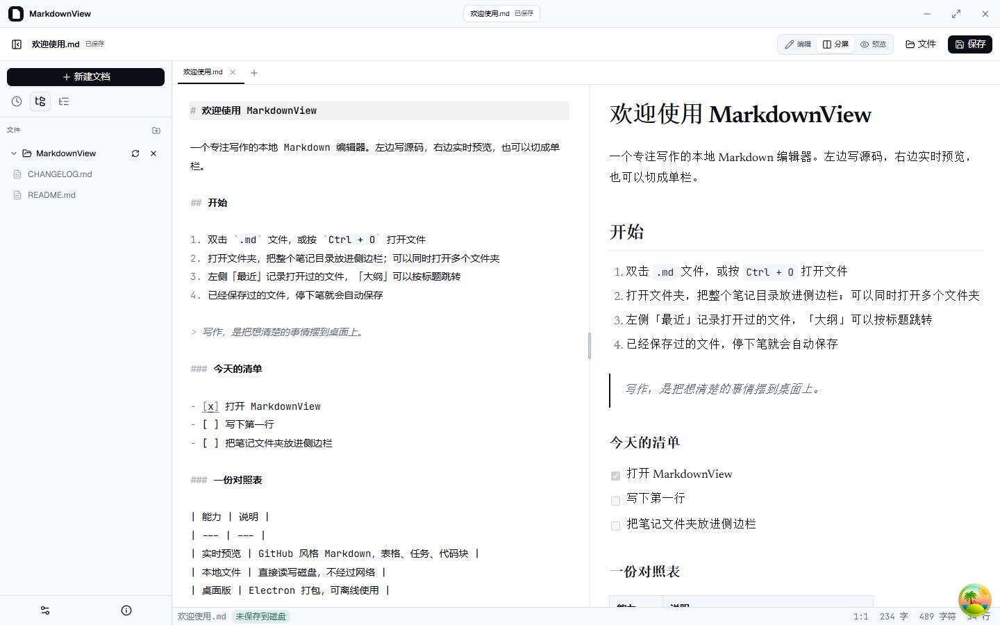
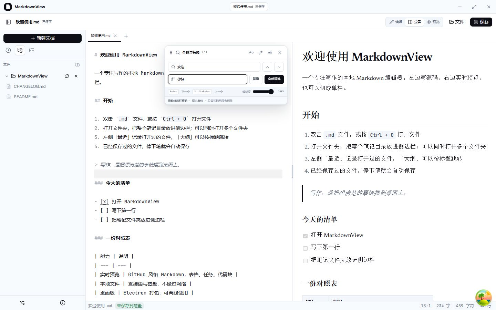

# MarkdownView

**轻到 6 MB，实时预览快到像在纸上落笔。**

MarkdownView 是一个为长时间写作而生的本地 Markdown 编辑器：左边写源码，右边即时预览，所有文件只留在你的电脑里。

[下载 Windows 安装包](https://github.com/Eveerme/MarkdownView/releases/latest) · Windows 10/11 x64 · 安装包约 6 MB · 无需登录



## 为什么选择 MarkdownView

### 打开就写，不打断思路

单窗口完成源码、预览和分屏写作。切换视图会回到原来的阅读位置，新建文档直接进入编辑模式，标签页始终保留在顶部。

### 文件真正属于你

笔记就是磁盘上的 `.md` 文件。没有导入导出，没有私有格式，也没有后台服务。工作区、最近文件和偏好只保存在本机。

### 轻，但不简陋

安装包约 6 MB，使用系统 WebView2，不内嵌一整套浏览器。启动快、占用低，同时保留完整 Markdown 能力。

### 为长时间写作准备

专注模式、打字机模式、可调正文宽度、源码与预览同步滚动、目录大纲和实时字数统计，都在同一套界面里。

### 一套连续的现代工作台

自定义标题栏、全高侧栏、下划线文档标签和贴边内容区组成一个连续工作面。侧栏可以拖拽调宽，默认纯白冷灰配色，也可以切换暖纸、松林、墨夜等主题。

### 更新不打扰

静态更新清单不消耗 GitHub API 额度。检查、下载、安装都有明确反馈，下载显示进度，安装完成后自动重新打开应用。

## 界面

### 查找与替换

`Ctrl + F` 打开查找，`Ctrl + H` 展开替换。面板可以拖动到任意位置，双击标题栏复位，底部滑块可在 55%–100% 之间调整透明度；位置和透明度会记住。



## 核心功能

### 写作体验

- 编辑、分屏、预览三种视图；切换时保留阅读位置
- 分屏比例可拖拽，双击分隔条恢复 50%
- 专注模式淡化非当前段落，打字机模式让光标行停在编辑区中央
- 源码/正文字号、正文宽度、自动换行、行号均可调
- 常驻多标签页，切换不丢未保存内容，也不丢各自的阅读位置
- 新建文档默认进入编辑模式

### 文件与工作区

- 打开单个 `.md` / `.markdown` 文件，或同时打开多个笔记文件夹
- 侧栏支持最近、文件、大纲三种视图，宽度可拖拽并记住
- 文件树按真实目录展示，右键可在资源管理器中打开
- 最近文件、已打开文件夹和工作区重启后自动恢复
- 自动保存，停止输入约 1 秒写回磁盘
- 新建、打开文件或关闭窗口前，如有未保存修改会先确认

### Markdown

- GitHub Flavored Markdown：表格、任务列表、删除线、围栏代码块、代码高亮
- 编辑中的单个换行在预览和导出 HTML 中保持为换行
- KaTeX 数学公式、Mermaid 图表
- YAML 元信息折叠为元信息面板，正文不显示原始 YAML
- 点击预览中的段落、标题或列表，光标跳到对应源码行
- 相对链接可直接打开其他笔记，并滚动到 `#标题`
- 粘贴或拖入图片自动保存到笔记旁的 `assets/`，插入相对链接

### 搜索、导出与更新

- 可拖动、可调透明度的查找替换面板，支持大小写、正则和全词匹配
- 导出独立 HTML，本地图片内嵌为 data URL
- 关于面板显示版本、Tauri / WebView / 平台信息
- 更新检查有请求中、成功、失败提示；安装包 SHA-256 校验后才会启动

## 快捷键

| 快捷键                   | 功能           |
| ------------------------ | -------------- |
| `Ctrl/Cmd + N`           | 新建文档       |
| `Ctrl/Cmd + O`           | 打开文件       |
| `Ctrl/Cmd + S`           | 保存           |
| `Ctrl/Cmd + Shift + S`   | 另存为         |
| `Ctrl/Cmd + F`           | 查找           |
| `Ctrl/Cmd + H`           | 查找与替换     |
| `Ctrl/Cmd + Tab`         | 下一个标签页   |
| `Ctrl/Cmd + Shift + Tab` | 上一个标签页   |
| `Ctrl/Cmd + W`           | 关闭当前标签页 |
| `Ctrl/Cmd + ,`           | 打开设置       |

## 安装

从 [Releases](https://github.com/Eveerme/MarkdownView/releases/latest) 下载最新的 Windows 安装包并运行。

> 安装包尚未进行代码签名，Windows SmartScreen 可能提示“未知发布者”。选择“更多信息 → 仍要运行”即可。

安装时会注册 `.md` / `.markdown` 文件关联，双击文件即可在应用内打开。如果系统里已有其他默认 Markdown 应用，可能需要在 Windows 设置中手动切换。

## 技术栈

| 层     | 技术                                                                   |
| ------ | ---------------------------------------------------------------------- |
| 前端   | React 19、TanStack Router、TanStack Query、Tailwind CSS 4              |
| UI     | shadcn/ui（Base UI）、lucide-react                                     |
| 编辑器 | CodeMirror 6（`@uiw/react-codemirror`、`@codemirror/search`）          |
| 预览   | react-markdown、remark-gfm、remark-breaks、remark-math、KaTeX、Mermaid |
| 桌面端 | Tauri 2（Rust）、系统 WebView2、NSIS                                   |
| 工具链 | Vite+（`vp`）、TypeScript、Vitest、Playwright、Knip、Ultracite         |

## 开发

### 环境要求

- Node.js `24.22.0`
- pnpm `12.14.0`
- [Vite+](https://viteplus.dev/) CLI（确保终端中可以执行 `vp`）
- Rust 稳定版（`rustup`）与 Visual Studio C++ 构建工具
- Windows 10/11 x64（当前安装包验证平台；WebView2 由安装包引导安装）

### 本地运行

```sh
git clone https://github.com/Eveerme/MarkdownView.git
cd MarkdownView
vp install
vp run dev
```

`vp run dev` 会同时启动 Web 开发服务器（<http://localhost:5173>）和 Tauri 窗口。修改 Rust 代码后 Tauri 会自动重建。

### 常用命令

| 命令                     | 说明                                                 |
| ------------------------ | ---------------------------------------------------- |
| `vp run dev`             | 启动 Web + Tauri 开发环境                            |
| `vp test`                | 运行单元测试（Vitest）                               |
| `vp run test:e2e`        | 运行端到端测试（Playwright，使用本机 Google Chrome） |
| `vp check`               | 格式化、Lint、类型检查                               |
| `vp run knip`            | 检查未使用的文件、导出与依赖                         |
| `vp run ready`           | 依次执行 check、knip、单元测试、端到端测试和生产构建 |
| `vp run package:desktop` | 打包 Windows 桌面安装程序                            |

端到端测试驱动已安装的 Google Chrome（`channel: "chrome"`），不需要额外下载 Playwright 浏览器。

### 项目结构

```text
.
├─ apps/
│  ├─ web/                  # React SPA：界面、编辑器、预览
│  │  ├─ src/components/workspace/
│  │  ├─ src/lib/
│  │  └─ tests/e2e/         # Playwright 端到端测试
│  └─ desktop/              # Tauri 应用：Rust 命令、配置与图标
│     └─ src-tauri/
├─ packages/
│  ├─ desktop-contract/     # 命令名、Zod 校验与 window.desktop 类型
│  ├─ ui/                   # shadcn/ui 组件与全局主题样式
│  └─ config/               # 共享 TypeScript 配置
├─ docs/                    # 文档与截图
└─ vite.config.ts
```

## 实现说明

<details>
<summary>本地优先与文件访问</summary>

阅读、编辑、自动保存都直接操作磁盘文件；应用不依赖后端服务。Rust 侧维护已打开文件/文件夹白名单，只处理用户通过系统对话框授权的路径，并校验相对链接与图片路径 containment。

桌面命令返回值全部经过 Zod 校验；WebView 通过 CSP 限制脚本、样式与图片来源。文件夹扫描递归查找 `.md` / `.markdown`，最多 16 层、5000 个文件，忽略隐藏目录以及 `node_modules`、`dist`、`release`。

</details>

<details>
<summary>工作区、最近文件与链接</summary>

同时打开的根目录保存在应用数据目录（`folders.json`），启动时自动恢复，已不存在的目录会被跳过。最近打开记录保存在 `recent-files.json`，最多保留 50 条，侧栏按设置显示（默认 10 条）。

相对链接只解析当前文件所在目录及其子目录、以及已打开工作区中的 Markdown 文件；`http/https/mailto` 等外部链接交给系统浏览器。目标带 `#标题` 时，加载后会滚动到对应标题。

</details>

<details>
<summary>图片、导出与更新</summary>

预览通过 `mdview://` 协议读取图片，只允许已打开工作区内、允许的图片扩展名，并用 `realpath` 校验真实路径，防止目录穿越；单张图片上限 25 MB。

HTML 导出把 Markdown 重新渲染成自含样式的文档，本地图片转为 data URL；公式样式与 Mermaid SVG 一并内嵌。发布工作流在打 `v*` 标签时生成 `latest.json` 并发布到 GitHub Pages，主进程校验 SHA-256 后才打开安装程序。

</details>

## 已知限制

- 当前只验证了 Windows x64 安装包；macOS 与 Linux 的构建配置已存在，但未做发布验证。
- 安装包未进行代码签名，Windows SmartScreen 可能提示“未知发布者”。
- 相对链接只支持 Markdown 文件；指向 PDF、图片等本地文件的链接暂不会用系统程序打开。
- 以 `.` 开头的隐藏目录不会出现在文件树中。
- 浏览器预览模式没有文件树和目录大纲，这两项功能在桌面版提供。
- 暂不支持导出 Word 或 PDF。

## 参与开发

1. Fork 本仓库并创建功能分支。
2. 修改代码后运行 `vp run ready`，确保格式、Lint、类型、单元测试、端到端测试和构建全部通过。
3. 提交 Pull Request。

遇到问题或有功能建议，欢迎在 [Issues](https://github.com/Eveerme/MarkdownView/issues) 中反馈。

## 致谢

界面与交互参考了 Typora、Branchline 一类专注写作与开发工具的现代工作台思路。感谢 Vite+、Tauri、Rust、React、CodeMirror、react-markdown、shadcn/ui 等开源项目。
