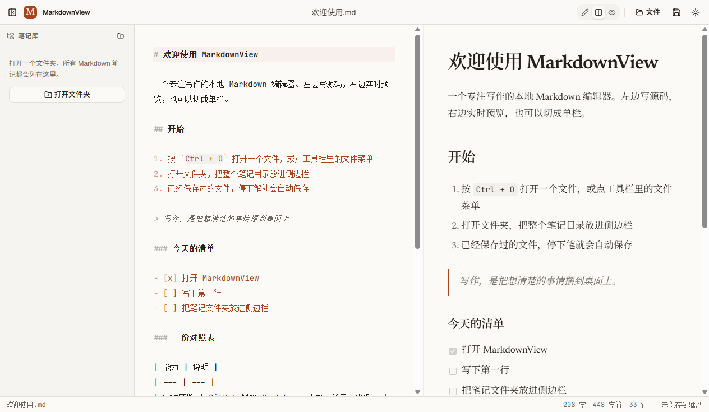

# MarkdownView

一个专注写作、离线可用的本地 Markdown 编辑器。左侧写源码，右侧实时预览，笔记直接读写本地磁盘，不经过网络。

**下载安装包**：[GitHub Releases](https://github.com/Eveerme/MarkdownView/releases/latest) · Windows 10/11 x64



## 功能特性

- **三种视图**：编辑、分屏、预览随时切换，分屏比例可拖动调整并记住上次的位置，双击分隔条恢复 50%。
- **同步滚动**：分屏时两侧按源码行对齐滚动，一边预览一边改，位置始终跟得上；也可以在设置里关掉。
- **预览定位源码**：在分屏里点击预览中的任意段落、标题或列表，光标直接跳到对应的源码行。
- **Markdown 源码编辑**：CodeMirror 6 提供 Markdown 语法高亮、自动换行和当前行提示，单栏排版更适合写作；行号默认关闭，需要时在设置里打开。
- **实时预览**：支持 GitHub Flavored Markdown（GFM），包括表格、任务列表、删除线、围栏代码块与代码高亮。
- **设置面板**：工具栏齿轮或 `Ctrl + ,` 打开，可调源码/正文字号、编辑与预览共用的正文宽度、自动换行、行号、同步滚动和自动保存，偏好保存在本机并立即生效。
- **本地文件**：打开单个 `.md` / `.markdown` 文件，或同时打开多个笔记文件夹，在文件树中浏览。
- **本地图片**：预览按笔记所在目录加载相对路径图片；把图片粘贴或拖入编辑器，会自动存到笔记旁的 `assets/` 并插入相对链接。
- **文件树**：按真实目录层级展示 Markdown 文件，文件夹可折叠；工作区里的多个根目录会一起保留，重启后自动恢复。
- **相对链接跳转**：点击预览里的 `[其他笔记](note.md)` 或 `[章节](note.md#标题)` 会在应用内打开目标文件，并滚动到对应标题。
- **目录大纲**：侧边栏「大纲」实时列出当前文档的标题，点击即可在编辑器和预览之间定位。
- **双击打开**：安装包会注册 `.md` / `.markdown` 文件关联，双击文件即可在应用内打开；应用已运行时再次打开文件会复用当前窗口。
- **最近打开**：侧边栏记录最近打开的 10 个 Markdown 文件，显示打开时间，可直接从历史记录回到文件，也可以一键清空。
- **自动保存**：已经保存到磁盘的文件，停止输入约 1 秒后自动写回；新文档在第一次保存时选择位置。不需要时可在设置里关闭。
- **避免误丢内容**：新建、打开文件或关闭窗口前，如果存在未保存修改，会先弹出确认。
- **导出分享**：把当前文档导出为独立的 HTML，或通过 Electron 打印为 PDF；HTML 中的本地图片会内嵌为 data URL，换一台电脑也能直接查看。
- **主题**：纸白、羊皮纸、松林、纯白、墨夜、午夜蓝六种配色，也可以跟随系统；主题菜单带纸张色点，编辑器、预览与导出共用同一套配色变量。
- **写作状态**：状态栏实时显示光标行列号、选中字数、全文词数、字符数、行数和保存状态。
- **记住窗口**：桌面版关闭时保存窗口大小、位置和最大化状态，下次打开回到原处；显示器拔掉后会自动回到可见区域。
- **关于面板**：工具栏的“关于”入口显示版本号、Electron / Chromium / Node 版本，以及 GitHub 仓库、最新版本和问题反馈链接。
- **纯本地运行**：无账号、无云端、无遥测；文件访问通过受限的 Electron IPC 完成。

## 技术栈

| 层     | 技术                                                           |
| ------ | -------------------------------------------------------------- |
| 前端   | React 19、TanStack Router、TanStack Query、Tailwind CSS 4      |
| UI     | shadcn/ui（Base UI）、lucide-react                             |
| 编辑器 | CodeMirror 6（`@uiw/react-codemirror`）                        |
| 预览   | react-markdown、remark-gfm、rehype-slug、rehype-highlight      |
| 大纲   | remark-parse、github-slugger                                   |
| 桌面端 | Electron 44、electron-builder（NSIS）                          |
| 工具链 | Vite+（`vp`）、TypeScript、Vitest、Playwright、Knip、Ultracite |

## 快速开始

### 环境要求

- Node.js `24.22.0`
- pnpm `12.14.0`
- [Vite+](https://viteplus.dev/) CLI（确保终端中可以执行 `vp`）
- Windows 10/11 x64（当前安装包验证平台）

> 版本由仓库根目录 `package.json` 的 `engines` 字段固定；Vite+ 也可以帮助管理运行时和包管理器。

### 安装与开发

```sh
git clone https://github.com/Eveerme/MarkdownView.git
cd MarkdownView
vp install
vp run dev
```

`vp run dev` 会同时启动 Web 开发服务器（<http://localhost:5173>）和 Electron 窗口。修改主进程或 preload 代码后，需要重启该命令。

### 构建

```sh
vp run build           # 构建 Web 渲染层、主进程与 preload
vp run package:desktop # 生成 Windows 安装包
```

安装包输出到 `apps/desktop/release/`，文件名形如 `MarkdownView Setup <版本>.exe`。

国内网络下载 Electron / electron-builder 依赖较慢时，可以先设置镜像：

```powershell
$env:ELECTRON_MIRROR = "https://npmmirror.com/mirrors/electron/"
$env:ELECTRON_BUILDER_BINARIES_MIRROR = "https://npmmirror.com/mirrors/electron-builder-binaries/"
vp run package:desktop
```

## 常用命令

| 命令                     | 说明                                                 |
| ------------------------ | ---------------------------------------------------- |
| `vp run dev`             | 启动 Web + Electron 开发环境                         |
| `vp test`                | 运行单元测试（Vitest）                               |
| `vp run test:e2e`        | 运行端到端测试（Playwright，使用本机 Google Chrome） |
| `vp check`               | 格式化、Lint、类型检查                               |
| `vp run knip`            | 检查未使用的文件、导出与依赖                         |
| `vp run ready`           | 依次执行 check、knip、单元测试、端到端测试和生产构建 |
| `vp run package:desktop` | 打包 Windows 桌面安装程序                            |

端到端测试驱动已安装的 Google Chrome（`channel: "chrome"`），不需要额外下载 Playwright 浏览器。

## 快捷键

| 快捷键                 | 功能     |
| ---------------------- | -------- |
| `Ctrl/Cmd + N`         | 新建文档 |
| `Ctrl/Cmd + O`         | 打开文件 |
| `Ctrl/Cmd + S`         | 保存     |
| `Ctrl/Cmd + Shift + S` | 另存为   |

## 项目结构

```text
.
├─ apps/
│  ├─ web/                  # React SPA：界面、编辑器、预览
│  │  ├─ src/components/workspace/
│  │  ├─ src/lib/
│  │  └─ tests/e2e/         # Playwright 端到端测试
│  └─ desktop/              # Electron 主进程、preload、打包配置
│     ├─ src/main/
│     └─ src/preload/
├─ packages/
│  ├─ electron/             # IPC 通道、数据校验与 window.desktop 类型
│  ├─ ui/                   # shadcn/ui 组件与全局主题样式
│  └─ config/               # 共享 TypeScript 配置
├─ docs/                    # 文档与截图
└─ vite.config.ts
```

## 实现说明

- **本地优先**：阅读、编辑、自动保存都直接操作磁盘文件；应用不依赖后端服务。
- **受限文件访问**：主进程会校验 IPC 发送方来源，并只允许访问用户通过系统对话框授权的文件或文件夹。
- **输入校验**：IPC 请求和响应均使用 Zod 校验，渲染进程启用 `contextIsolation` 与 `sandbox`。
- **文件夹扫描**：递归查找 `.md` / `.markdown` 文件，最多 16 层、5000 个文件，忽略隐藏目录以及 `node_modules`、`dist`、`release`；超出上限时会在文件夹标题下提示。
- **工作区**：同时打开的根目录保存在 Electron 的 `userData` 目录（`folders.json`），启动时自动恢复，已不存在的目录会被跳过。
- **最近打开**：记录保存在 `userData/recent-files.json`，包含打开时间；只记录通过应用打开或保存过的 Markdown 文件，文件被删除后会自动从列表移除。
- **相对链接**：只解析当前文件所在目录及其子目录、以及已打开工作区中的 Markdown 文件；`http/https/mailto` 等外部链接仍交给系统浏览器。目标文件带有 `#标题` 时，加载后会滚动到对应标题。
- **本地图片**：预览通过 `mdview://` 协议读取图片，只允许已打开工作区内、允许的图片扩展名，并用 `realpath` 校验真实路径，防止目录穿越；单张图片上限 25 MB。粘贴或拖入的图片保存为 `assets/image-<时间>-<随机>.png` 一类文件名。
- **目录大纲**：使用与预览相同的标题锚点规则生成，支持中文标题和重复标题；编辑模式下点击大纲会定位到源码行。
- **导出**：HTML 导出把 Markdown 重新渲染成一份自含样式的文档，本地图片转为 data URL；PDF 在隐藏窗口中用 `printToPDF` 生成，打印样式固定为浅色纸张、A4 页面并避免标题与图表被截断。
- **Web 降级**：浏览器中打开时自动隐藏文件操作和侧边栏，仅保留编辑与预览；完整文件读写需要桌面版。
- **外部链接**：预览中的外部链接交由系统默认浏览器打开，不在应用窗口内导航。

## 已知限制

- 当前只验证了 Windows x64 安装包；macOS 与 Linux 的构建配置已存在，但未做发布验证。
- 安装包未进行代码签名，Windows SmartScreen 可能提示“未知发布者”。选择“更多信息 → 仍要运行”即可。
- 安装时会注册 `.md` / `.markdown` 文件关联；如果系统里已有其他默认 Markdown 应用，可能需要在 Windows 设置中手动把默认应用切换为 MarkdownView。
- 相对链接只支持 Markdown 文件；指向 PDF、图片等本地文件的链接暂不会用系统程序打开。
- 以 `.` 开头的隐藏目录不会出现在文件树中。
- 浏览器预览模式没有文件树和目录大纲，这两项功能在桌面版提供。
- 暂不支持导出 Word 文档。

## 参与开发

1. Fork 本仓库并创建功能分支。
2. 修改代码后运行 `vp run ready`，确保格式、Lint、类型、单元测试、端到端测试和构建全部通过。
3. 提交 Pull Request。

如果遇到问题或有功能建议，欢迎在 [Issues](https://github.com/Eveerme/MarkdownView/issues) 中反馈。

## 致谢

界面与交互参考了 Typora 一类专注写作工具的思路。感谢 Vite+、Electron、React、CodeMirror、react-markdown、shadcn/ui 等开源项目。
